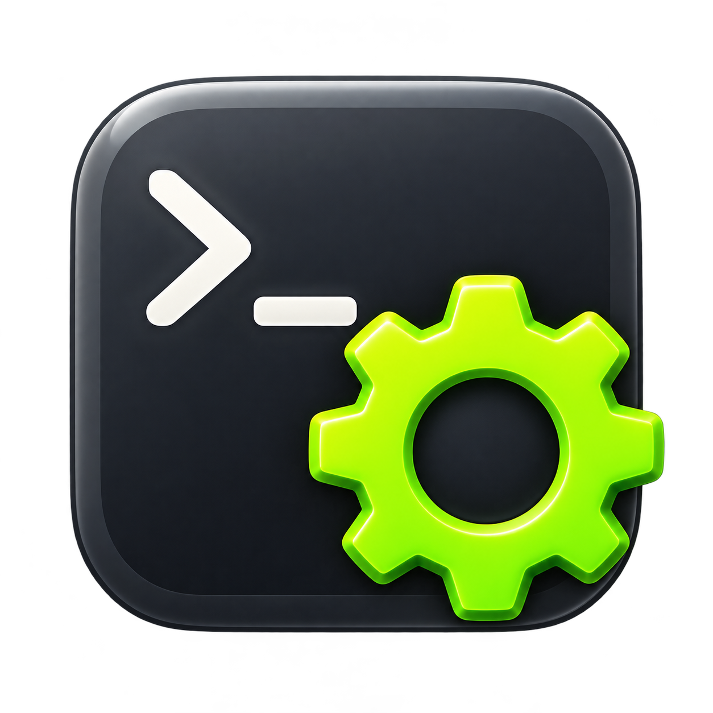

# macosterminalextended



**Extended Terminal** adds copy on selection, keyboard navigation, Zsh selection, and a dark profile to Apple's Terminal.app.

[Download the installer](https://github.com/amstel8/macosterminalextended/releases/latest) · [Features](docs/FEATURES.md) · [Installation](docs/INSTALLATION.md) · [Usage](docs/USAGE.md)

## Features

- Mouse selection is copied when you release the button.
- **Control + Left / Right** moves to the start / end of the shell input line.
- **Control + Up / Down** moves to the beginning / end of the entire multiline input.
- **Option + Left / Right** moves backward / forward by words.
- **Option + Shift + Left / Right** selects words in Zsh.
- **Control + Shift + Left / Right** selects to the start / end of the Zsh input line.
- **Control + Shift + Up / Down** selects to the beginning / end of the entire Zsh input.
- **Shift + Enter** inserts a newline into the Zsh input buffer without submitting it.
- Keyboard selections are copied too; Backspace/Delete removes the selected region.
- Command + arrow shortcuts retain Terminal's native behavior.
- Settings live in the **Extended Terminal** pane in Monterey's System Preferences.
- A hidden background helper provides Accessibility access and keyboard handling; no application is installed into Applications, and no menu bar or Dock icon is created.
- Includes login startup and the full **iTerm Dark** profile with Monaco 12 and a backup before theme changes.

## Install

Download `macosterminalextended-0.3.2.pkg` from [Releases](https://github.com/amstel8/macosterminalextended/releases/latest). The package includes universal binaries for Intel and Apple Silicon. System Preferences integration is validated on **macOS 12 Monterey**; newer versions are not validated.

Open **System Preferences → Extended Terminal**. Grant Accessibility access to the hidden helper, and allow control of Terminal under Automation to apply the theme. Open a **new Zsh tab** after installation to load keyboard selection.

The installer preserves your existing `.zshrc`, creates a backup, and appends one marked source block. Selection integration runs only in interactive Zsh under Apple's Terminal.

## Build

Requires Xcode Command Line Tools. No network downloads are needed at build time.

```sh
zsh build.sh
python3 tests/check_shell_selection.py
zsh build-pkg.sh
```

The installer and SHA-256 checksum are written to `dist/`. The background helper and preference pane are built under `build/`.

The build runs 11 selection checks and 13 shortcut checks. The PTY test exercises actual Zsh word and line selection, extension, shrinkage, and deselection. The package is locally built without Developer ID signing or notarization.

## Limits

Line movement sends Control + A / E. Keyboard selection applies to Zsh's editable command line, not terminal scrollback, SSH shells without this integration, or applications such as vim.

Mouse selection is checked every 150 ms. Very brief selections may be missed. Returning to Terminal with an existing selection does not overwrite the clipboard.

Selection text is not logged or sent over the network.

The Zsh integration includes MIT-licensed [zsh-shift-select](https://github.com/jirutka/zsh-shift-select); see [third-party notices](THIRD_PARTY_NOTICES.md).
